<div align="center">

  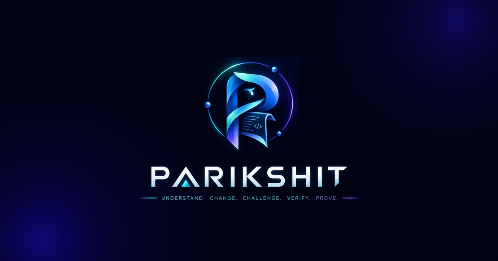

  <br /><br />

  <h1>🛡️ PARIKSHIT (परीक्षित)</h1>
  <p><strong>The Grounded, Adversarially-Tested AI Engineering Teammate</strong><br />
  <em>Understand &bull; Change &bull; Challenge &bull; Verify &bull; Prove</em></p>

  <p>
    <a href="https://parikshit-six.vercel.app/" target="_blank">
      
    </a>
  </p>

  <p>
    <a href="https://github.com/me13krishna/Parikshit/stargazers"></a>
    <a href="https://github.com/me13krishna/Parikshit/network/members"></a>
    <a href="https://github.com/me13krishna/Parikshit/actions"></a>
    
    
    
    
    
    
    <a href="./LICENSE"></a>
  </p>

  <p>
    <a href="#-try-the-live-mvp-zero-setup"><strong>🌐 Live MVP</strong></a> &nbsp;&bull;&nbsp;
    <a href="#-what-is-parikshit"><strong>🎯 What is Parikshit?</strong></a> &nbsp;&bull;&nbsp;
    <a href="#-visual-product-tour"><strong>📸 Visual Tour</strong></a> &nbsp;&bull;&nbsp;
    <a href="#-the-5-stage-pipeline"><strong>🔄 5-Stage Pipeline</strong></a> &nbsp;&bull;&nbsp;
    <a href="#-quick-start"><strong>⚡ Quick Start</strong></a> &nbsp;&bull;&nbsp;
    <a href="#%EF%B8%8F-system-architecture"><strong>🏗️ Architecture</strong></a> &nbsp;&bull;&nbsp;
    <a href="#-security--sandboxing"><strong>🔒 Security</strong></a>
  </p>

</div>

---

## 🌐 Try the Live MVP (Zero Setup!)

> [!TIP]
> ### 🚀 Experience Parikshit right now in your browser:
> 👉 **[https://parikshit-six.vercel.app/](https://parikshit-six.vercel.app/)**
> 
> * **Zero setup required**: Open the link and jump directly into the full Engineering Cockpit.
> * **Interactive Guided Tour**: Click **"Load Demo Calculator"** to immediately index a full arithmetic service with AST symbol trees and test suites.
> * **Explore the Software Twin**: Visualize dependency blast radiuses and ripple predictions before touching code.
> * **Audit the SHA-256 Ledger**: Inspect cryptographically chained events and export verifiable JSON Evidence Packs with a single click.

<div align="center">
  <a href="https://parikshit-six.vercel.app/" target="_blank">
    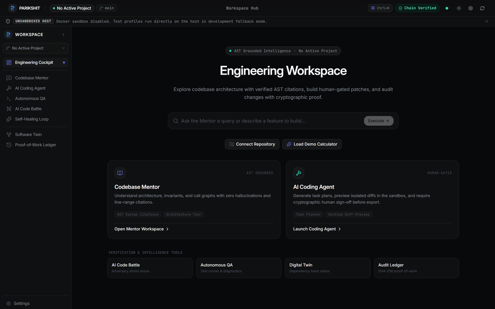
  </a>
  <p><em>The Parikshit Live MVP Cockpit running at <a href="https://parikshit-six.vercel.app/">parikshit-six.vercel.app</a> — Featuring AST-grounded intelligence, real-time telemetry, and cryptographic chain verification.</em></p>
</div>

---

## 🎯 What is Parikshit?

Most AI coding assistants are glorified conversational autocompletes. They run blindly on developer machines, hallucinate phantom functions, invent non-existent file paths, and leave engineers with **zero guarantees** about whether generated patches break boundary conditions or silently introduce security vulnerabilities.

**Parikshit** (परीक्षित — *the verified one*) redefines developer assistance from the ground up: **it is not a chatbot; it is a battle-hardened AI engineering teammate.**

Parikshit enforces an unbreakable verification contract across every single code modification:

```
┌─────────────────┐      ┌─────────────────┐      ┌─────────────────┐      ┌─────────────────┐      ┌─────────────────┐
│   UNDERSTAND    │ ───> │     CHANGE      │ ───> │    CHALLENGE    │ ───> │     VERIFY      │ ───> │      PROVE      │
│ Codebase Mentor │      │  Vibe Builder   │      │ AI vs AI Battle │      │  Software Twin  │      │ Cryptographic   │
│ AST Citations   │      │ Isolated Branch │      │  Adversary QA   │      │  & Self-Healing │      │ SHA-256 Ledger  │
└─────────────────┘      └─────────────────┘      └─────────────────┘      └─────────────────┘      └─────────────────┘
```

1. **AST-Grounded Understanding**: Every statement made about the codebase is validated server-side with precise line-range citations against AST syntax trees. Phantom claims and hallucinations are automatically rejected.
2. **Isolated Vibe Builder**: Code synthesis occurs strictly within isolated Git worktrees. Nothing touches your main branch without an explicit, cryptographic human sign-off gate.
3. **Adversarial AI vs AI Combat**: A dedicated Adversary Agent attacks the Builder’s patch with boundary mutations, zero-division, overflow attacks, and edge tests before changes can proceed.
4. **Software Twin & Self-Healing**: Hardened container sandboxes execute checks, simulate dependency blast radiuses, analyze failures, rank hypotheses, and autonomously apply self-healing fixes.
5. **Immutable Proof Ledger**: Every prompt, diff, test result, and review verdict is cryptographically hashed and chained into an append-only SHA-256 proof-of-work ledger, exportable as an audit-ready Evidence Pack.

---

## 📸 Visual Product Tour

Explore each stage of the Parikshit lifecycle in action:

### 1. 🧭 Understand — Grounded Codebase Mentor
*Ask complex architectural questions with line-by-line verified citations, inspect call graphs, and follow guided codebase onboarding walkthroughs.*

<div align="center">
  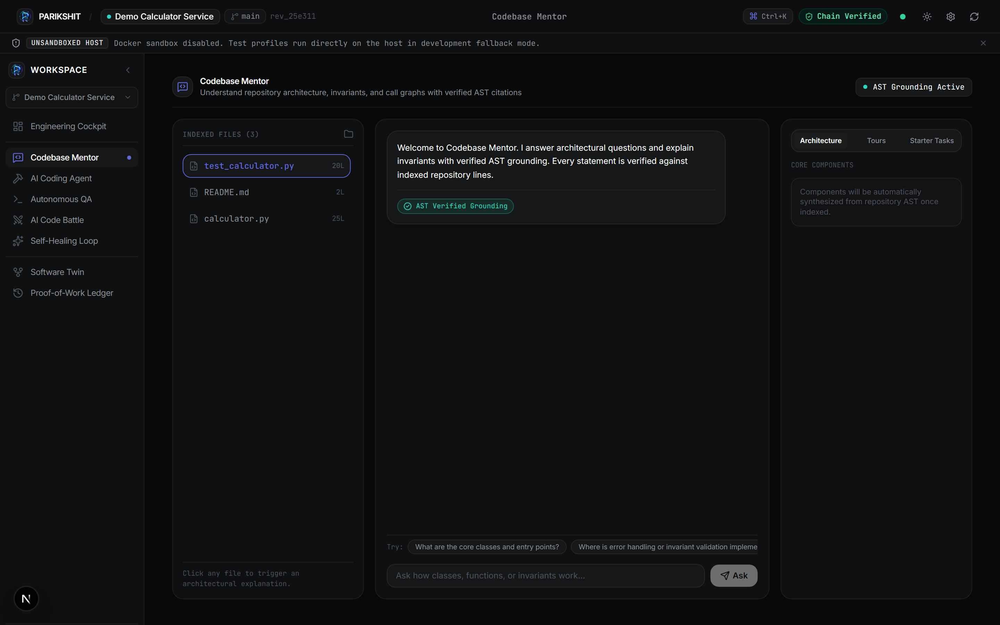
</div>

<br />

### 2. ⚡ Change — AI Coding Agent & Human Approval Gate
*Natural language feature synthesis and refactoring executed in isolated Git worktrees, complete with interactive unified diff inspection and mandatory human approval barriers.*

<div align="center">
  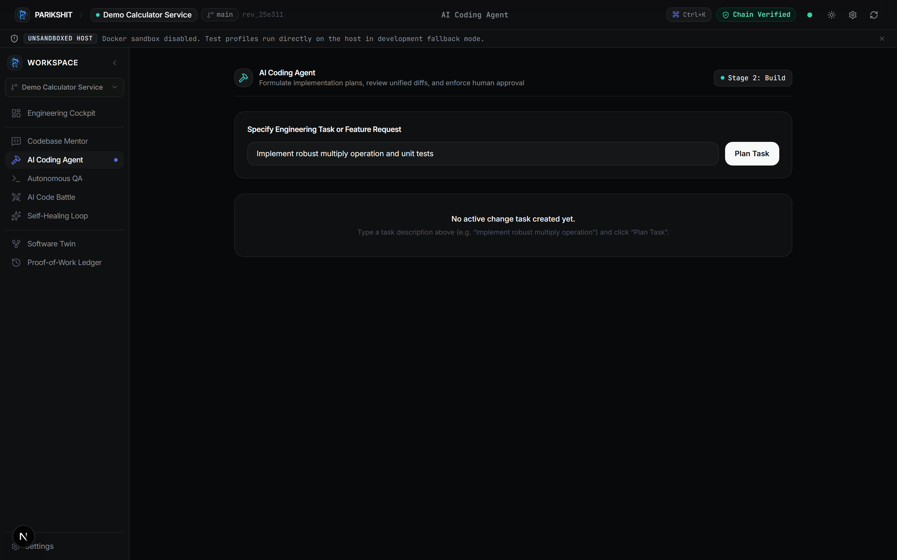
</div>

<br />

### 3. ⚔️ Challenge — Multi-Agent AI-vs-AI Battle Arena
*The signature adversarial arena: Builder Agent defends its solution while the Adversary Agent generates ruthless stress tests and mutation suites. Reviewer synthesizes residual risks.*

<div align="center">
  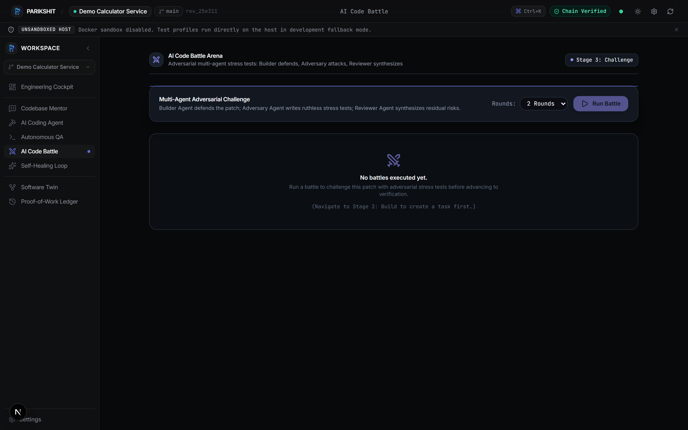
</div>

<br />

### 4. 🧪 Verify & Heal — Software Twin & Autonomous Self-Healing
*Simulate dependency ripple effects on an interactive AST node-link graph, execute test profiles in hardened sandboxes, and trigger closed-loop autonomous repair workflows.*

<div align="center">
  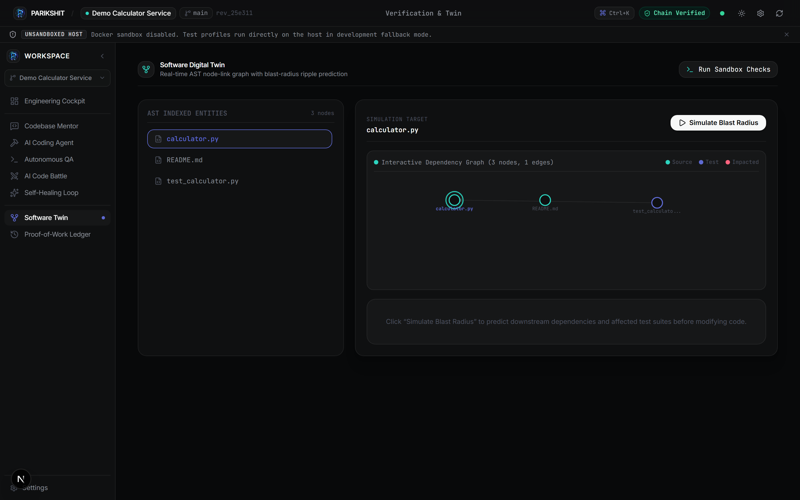
  <br /><br />
  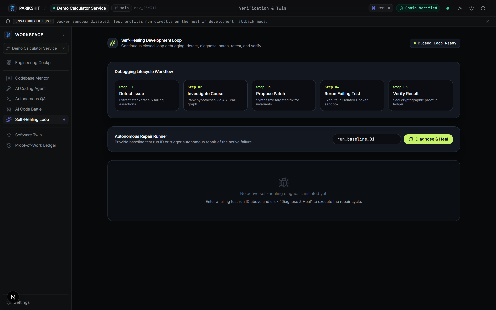
</div>

<br />

### 5. 🛡️ Prove — Cryptographic Proof-of-Work Ledger
*SHA-256 forward-and-backward hash-chained audit trail. Verify chain integrity on the fly and download tamper-evident JSON Evidence Packs for compliance and pull request review.*

<div align="center">
  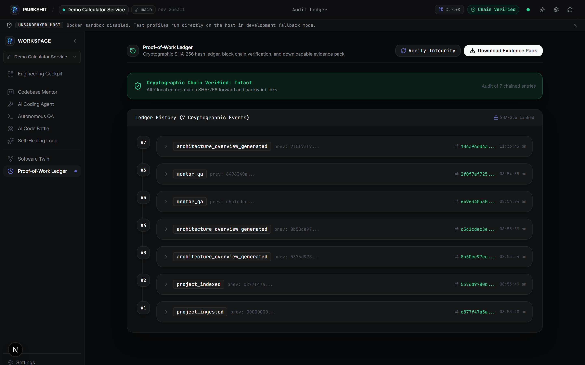
</div>

<br />

### ⌨️ Universal Command Palette (`Ctrl + K` / `Cmd + K`)
*Instant keyboard-driven navigation across stages, files, telemetry, and system actions.*

<div align="center">
  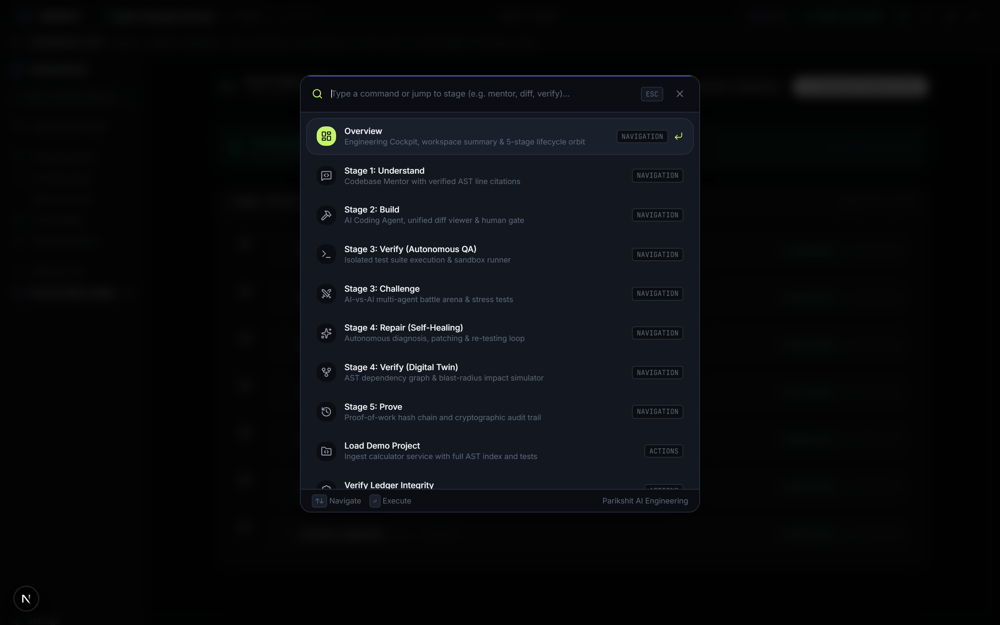
</div>

---

## ⚖️ Why Parikshit?

| Feature / Dimension | Standard Copilots & Chatbots | Autonomous Agents (Devin-style) | 🛡️ **Parikshit Teammate** |
|:---|:---:|:---:|:---|
| **Code Grounding** | Plausible hallucination | Best-effort grep heuristic | **100% AST-verified line-range citations; ungrounded claims rejected** |
| **Execution Safety** | None (Runs directly on host) | Docker container | **Isolated Git worktrees + non-root read-only container sandbox** |
| **Human In The Loop** | Blind copy-paste | Uncontrolled agent actions | **Mandatory Cryptographic Human Gate: Diff approval required** |
| **Adversarial QA** | None | User writes tests manually | **AI-vs-AI Battle: Builder vs Adversary vs Reviewer stress combat** |
| **Software Twin** | None | None | **AST dependency node-link graph with blast-radius ripple simulation** |
| **Self-Healing Loop** | Trial-and-error chat prompts | Infinite loop risks | **Closed-loop: Detect &rarr; Ranked Hypotheses &rarr; Patch &rarr; Re-verify** |
| **Audit & Provenance** | Ephemeral chat log | Plain text task log | **SHA-256 hash-chained immutable ledger + downloadable Evidence Pack** |

---

## 🏗️ System Architecture

### Component Architecture

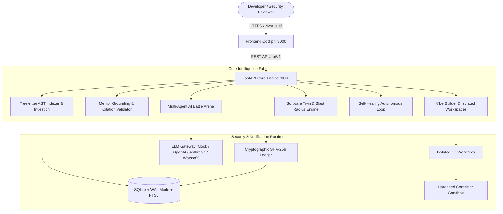

### Multi-Agent Battle & Self-Healing Workflow

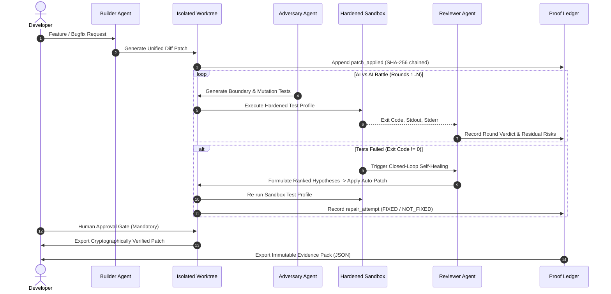

---

## 🚀 Quick Start

You can run Parikshit in 3 ways:

### 🌟 1. Web MVP (Instant Access, No Install)
Jump right in: **[https://parikshit-six.vercel.app/](https://parikshit-six.vercel.app/)**

---

### 🐳 2. Docker Compose (1-Command Full Stack)
Run both backend and cockpit in a isolated Docker environment:

```bash
git clone https://github.com/me13krishna/Parikshit.git
cd Parikshit
docker compose up --build
```
- **Cockpit Web UI:** [http://localhost:3000](http://localhost:3000)
- **FastAPI Core Engine:** [http://localhost:8000/api/v1/health](http://localhost:8000/api/v1/health)
- **Interactive OpenAPI Documentation:** [http://localhost:8000/docs](http://localhost:8000/docs)

---

### 💻 3. Local Development (Zero Third-Party API Keys Needed!)
Parikshit features an out-of-the-box **Deterministic Mock Engine** (`LLM_PROVIDER=mock`). You can evaluate all 5 stages locally with **zero API costs or keys**:

```bash
# 1. Clone repository
git clone https://github.com/me13krishna/Parikshit.git
cd Parikshit

# 2. Seed the demo arithmetic repository
python scripts/seed_demo_repo.py

# 3. Launch dev servers (Backend :8000 + Frontend :3000)
make dev
```

Open **[http://localhost:3000](http://localhost:3000)** and click **"Load Demo Calculator"** to begin exploring!

<details>
<summary><b>🛠️ Manual Step-by-Step Setup (Backend & Frontend)</b></summary>
<br />

**Backend Setup:**
```bash
cd backend
python -m venv .venv
source .venv/bin/activate  # On Windows: .venv\Scripts\Activate.ps1
pip install -r requirements-dev.txt
uvicorn app.main:app --reload --port 8000
```

**Frontend Setup (in a separate terminal):**
```bash
cd frontend
npm install --legacy-peer-deps
npm run dev
```
</details>

---

## ⚙️ Configuration Reference

All settings can be configured via `.env` or system environment variables:

| Variable | Default | Purpose |
|:---|:---:|:---|
| `PARIKSHIT_ENV` | `development` | Operating mode (`development`, `production`, `test`) |
| `PARIKSHIT_DATA_DIR` | `./data` | Directory for repositories, worktrees, and SQLite database |
| `PARIKSHIT_DB_URL` | `sqlite:///./data/parikshit.db` | SQLite database connection string (enforces WAL mode) |
| `LLM_PROVIDER` | `mock` | Active LLM backend: `mock`, `openai`, `anthropic`, `watsonx` |
| `OPENAI_API_KEY` | `""` | OpenAI API key (when using OpenAI models) |
| `OPENAI_BASE_URL` | `https://api.openai.com/v1` | Custom endpoint (compatible with Ollama, vLLM, LocalAI) |
| `ANTHROPIC_API_KEY` | `""` | Anthropic API key (when using Claude models) |
| `LLM_DEFAULT_MODEL` | `gpt-4o-mini` | General fallback model |
| `LLM_BUILDER_MODEL` | `gpt-4o` | Model driving the Builder Agent |
| `LLM_ADVERSARY_MODEL`| `gpt-4o` | Model driving the Adversary Agent |
| `LLM_REVIEWER_MODEL` | `gpt-4o-mini` | Model synthesizing battle verdicts |
| `LLM_DAILY_BUDGET_USD`| `20.00` | Hard spending guardrail on daily LLM expenditure |
| `SANDBOX_ENABLED` | `false` | Enable Docker container isolation for test runs |
| `SANDBOX_TIMEOUT_SEC`| `120` | Container execution timeout limit |
| `ALLOWED_GIT_HOSTS` | `github.com,gitlab.com,bitbucket.org` | Allowlist for HTTPS repository ingestion |
| `AUTH_DISABLED` | `true` | When `false`, enforces strict `X-API-Key` headers |

---

## 🔒 Security & Sandboxing Model

For full details on our threat model and vulnerability disclosure, read [`SECURITY.md`](./SECURITY.md).

* 🛡️ **Zero Arbitrary Execution**: Check profiles enforce strict command allowlists (`pytest`, `pytest_coverage`). Ad-hoc commands are rejected immediately with `HTTP 400`.
* 📦 **Container Hardening**: Docker sandboxes execute with non-root UID (`1000:1000`), read-only root filesystems, dropped capabilities (`--cap-drop ALL`), strict PID limits, and disabled networking (`--network none`).
* 🔗 **Cryptographic Immutability**: SQLite database triggers reject all `UPDATE` and `DELETE` queries on `ledger_entries`. Ledger integrity can be verified at any time via:
  ```bash
  python scripts/verify_ledger.py
  ```
* 🚧 **Mandatory Human Approval Gate**: Code synthesis remains strictly contained within isolated Git worktrees until an engineer reviews the diff and explicitly clicks approve.

---

## 🧪 Developer Tooling & Testing

```bash
# Run complete test suite (Backend Pytest + Frontend Vitest)
make test

# Run backend tests with 75%+ coverage enforcement
make test-backend

# Run frontend test suite
make test-frontend

# Run code formatters and linters (Ruff + ESLint)
make lint

# Verify cryptographic hash chain integrity
python scripts/verify_ledger.py
```

---

## 📁 Repository Layout

```
Parikshit/
├── backend/                  # FastAPI Core Engine
│   ├── app/
│   │   ├── api/              # REST Endpoints (mentor, builder, battle, twin, ledger)
│   │   ├── services/         # AST indexer, grounding, self-healing, ledger
│   │   ├── models/           # Pydantic schemas & SQLite models
│   │   └── core/             # Config, security, database & LLM gateway
│   └── tests/                # Comprehensive unit & integration test suite
├── frontend/                 # Next.js 16 + React 19 Cockpit
│   ├── src/
│   │   ├── app/              # App router & layout
│   │   ├── components/       # Cockpit, Mentor, Builder, Battle, Twin, Ledger
│   │   └── lib/              # API client, types, state management
│   └── public/               # Brand assets and icons
├── docs/                     # Specifications & Design System
│   ├── assets/               # Brand banners, logos, and marks
│   ├── images/ui/            # High-resolution screenshots of all 5 stages
│   └── *.md                  # PRD, Architecture, Data Dictionary, Security
├── scripts/                  # Seed demo repo, verify ledger, capture screenshots
└── docker-compose.yml        # Multi-container orchestration
```

---

## 📄 License & Community

- **License:** [MIT](./LICENSE)
- **Live MVP Demo:** [parikshit-six.vercel.app](https://parikshit-six.vercel.app/)
- **Contributing Guide:** [CONTRIBUTING.md](./CONTRIBUTING.md)
- **Code of Conduct:** [CODE_OF_CONDUCT.md](./CODE_OF_CONDUCT.md)
- **Security Policy:** [SECURITY.md](./SECURITY.md)
- **GitHub Setup Reference:** [`docs/GITHUB_SETUP.md`](./docs/GITHUB_SETUP.md)

<br />

<div align="center">
  <sub>Built with ❤️ by <strong>Team Vishwam</strong> for reliable, verified, and grounded AI software engineering.</sub>
</div>
