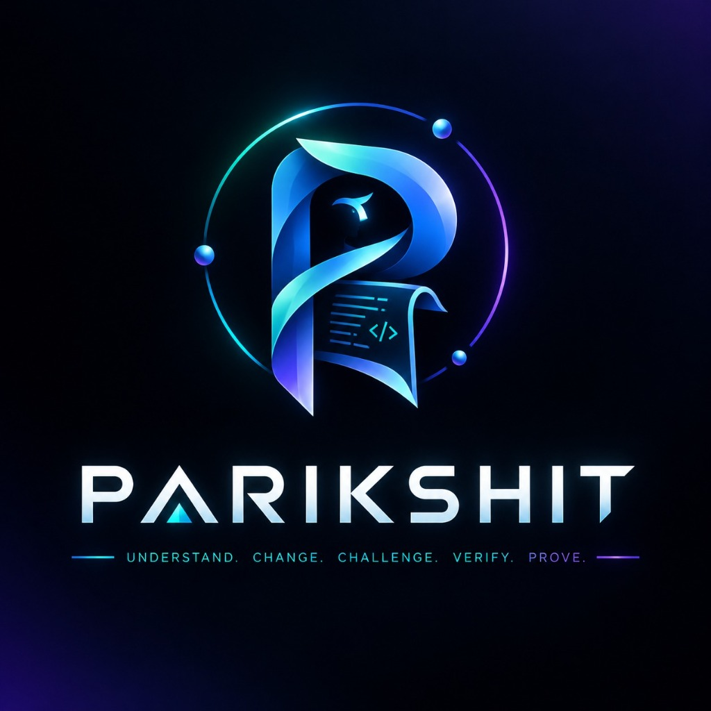

<p align="center">
  
</p>

# Parikshit – AI Engineering Teammate

**Tagline:** An AI engineering teammate that moves developers from unfamiliar code to verified changes: **understand → change → challenge → verify → prove**.

> **Team Vishwam** | GitHub: [https://github.com/me13krishna/Parikshit](https://github.com/me13krishna/Parikshit)

---

## 🌟 The 5 Pillars

1. **Grounded Retrieval + Citation Verification:** Every claim about code is backed by `path` + `start_line`..`end_line` citations validated server-side against actual source files before display.
2. **Isolated Execution & Human Gates:** Code changes and tests run inside isolated workspaces. No merges or exports occur without human approval.
3. **AI vs AI Battle (Signature Feature):** Multi-agent adversarial loop (`Builder` vs `Adversarial QA` vs `Reviewer`) producing concrete challenge test cases and residual risk reports.
4. **Proof-of-Work Ledger:** An immutable, hash-chained ledger (`SHA-256`) recording every significant action with downloadable evidence packs.
5. **Self-Healing Loop:** Autonomous diagnose (ranked hypotheses with citations) → patch → verify cycle with strict verdict taxonomy.

---

## 📁 Repository Layout

```
Parikshit/
├── frontend/             # Next.js App Router (TypeScript, Tailwind, Modern Dark UX)
├── backend/              # FastAPI modular monolith (Python 3.11+)
│   ├── app/
│   │   ├── api/          # REST & SSE endpoints (/api/v1)
│   │   ├── services/     # Ingestion, Indexer, Citations, Workspaces, Ledger
│   │   ├── agents/       # Multi-agent battle orchestrators & LLM gateway
│   │   ├── models/       # Pydantic schemas & SQLite models
│   │   └── core/         # Config, logging, security, error envelopes
│   ├── migrations/       # SQLite schema migrations
│   └── tests/            # Pytest test suite
├── sandbox/              # Dockerfile & sandbox execution runner
├── scripts/              # Development helpers & seed scripts
├── docs/                 # Full architecture & specification documentation
├── .env.example
├── docker-compose.yml
└── README.md
```

---

## 🚀 Quick Start

### 1. Backend Setup
```bash
cd backend
python -m venv .venv
# Activate on Windows:
.venv\Scripts\activate
# Activate on Unix:
source .venv/bin/activate

pip install -r requirements.txt
cp ../.env.example ../.env
uvicorn app.main:app --reload --port 8000
```
Health check: `http://localhost:8000/api/v1/health`  
API Docs: `http://localhost:8000/docs`

### 2. Frontend Setup
```bash
cd frontend
npm install
npm run dev
```
Access UI at `http://localhost:3000`

---

## 📚 Documentation

Complete documentation is located in [`docs/`](./docs/):
- [`01_PRD.md`](./docs/01_PRD.md) – Product requirements, personas, scope
- [`02_SYSTEM_ARCHITECTURE.md`](./docs/02_SYSTEM_ARCHITECTURE.md) – Architecture & tech stack
- [`03_IMPLEMENTATION_PLAN.md`](./docs/03_IMPLEMENTATION_PLAN.md) – Sprint roadmap & task breakdown
- [`04_DATA_DICTIONARY_AND_SCHEMA.md`](./docs/04_DATA_DICTIONARY_AND_SCHEMA.md) – SQLite data model & schema
- [`05_ENVIRONMENT_SETUP.md`](./docs/05_ENVIRONMENT_SETUP.md) – Dev environment & configuration
- [`06_SECURITY_ERROR_LOGGING.md`](./docs/06_SECURITY_ERROR_LOGGING.md) – Security model & logging
- [`07_API_CONTRACTS_SUMMARY.md`](./docs/07_API_CONTRACTS_SUMMARY.md) – REST + SSE API contracts
- [`08_AGENT_PROMPTS_SUMMARY.md`](./docs/08_AGENT_PROMPTS_SUMMARY.md) – Agent roles & safety prompt specifications
