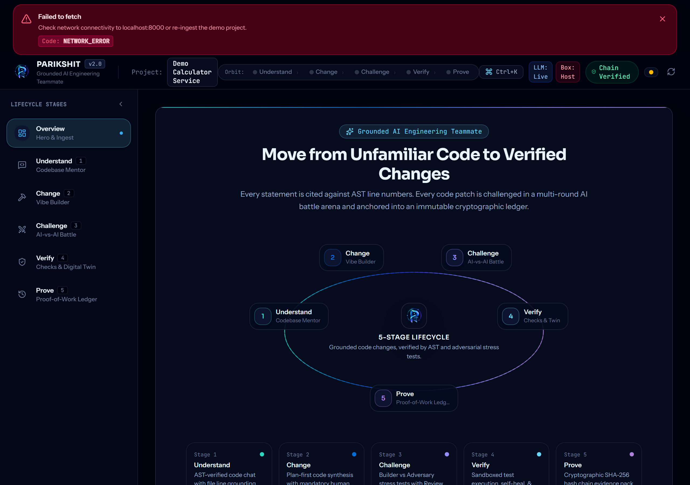
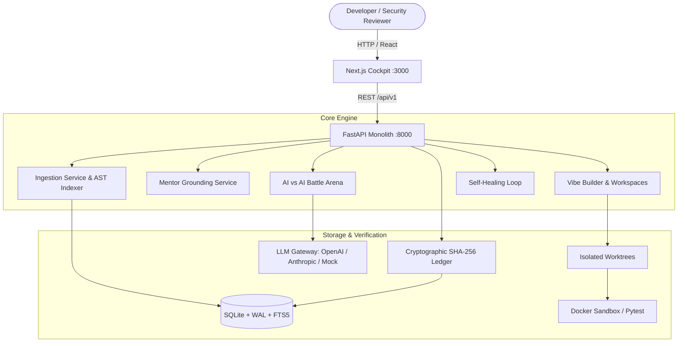
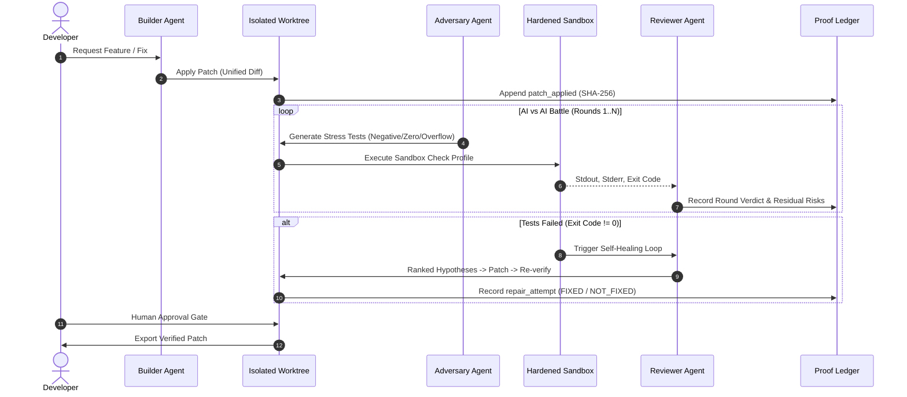

<p align="center">
  
</p>

<h1 align="center">Parikshit — Grounded AI Engineering Teammate</h1>

<p align="center">
  <em>Understand &rarr; Change &rarr; Challenge &rarr; Verify &rarr; Prove</em>
</p>

<p align="center">
  <a href="https://github.com/me13krishna/Parikshit/actions"></a>
  
  
  
  
</p>

---

## 🎯 What is Parikshit?

**Parikshit** is a verifiable AI engineering teammate designed to move developers safely from unfamiliar codebases to verified, production-ready changes. Unlike autocomplete tools and conversational chatbots that silently hallucinate or run unsandboxed scripts on your host, Parikshit operates on a strict verification contract: **understand &rarr; change &rarr; challenge &rarr; verify &rarr; prove**. Every factual claim is verified server-side against AST nodes; code changes execute in isolated worktrees gated by mandatory human approvals; an adversarial AI attacks every patch before it ships; and all steps are cryptographically anchored into a SHA-256 hash-chained proof-of-work ledger.

---

## 📸 Product Walkthrough & Screenshots

<p align="center">
  
</p>

> **Recording Playbook:** See [`scripts/record_demo.md`](./scripts/record_demo.md) for the complete 2-minute step-by-step recording guide covering Ingestion, Grounded Mentor, Vibe Builder, AI-vs-AI Battle, and the Ledger Audit.

---

## ⚖️ Why Parikshit? (Comparison)

| Dimension | Standard LLM Chatbots | Autocomplete / Copilot | **Parikshit Teammate** |
|---|---|---|---|
| **Code Grounding** | Untrusted hallucinations | Local open-file heuristic | **AST-verified line citations server-side; ungrounded claims rejected** |
| **Execution Safety** | None (User copies code) | Executed directly on user machine | **Isolated worktrees; hardened Docker container sandbox** |
| **Human Gate** | Unenforced | Code review after generation | **Cryptographic gate: patch export strictly blocked until approved** |
| **Adversarial QA** | None | User manually writes tests | **AI-vs-AI Battle Arena: Builder vs Adversary QA vs Reviewer** |
| **Proof & Audit Trail**| Ephemeral chat history | None | **SHA-256 hash-chained ledger; downloadable Evidence Pack JSON** |
| **Self-Healing** | Trial-and-error re-prompting | None | **Autonomous hypothesis ranking &rarr; patch &rarr; verify loop** |

---

## 🏛️ The Five Pillars (Implementation Status)

| Pillar | Focus | Status | Implementation Details |
|---|---|---|---|
| **1. Grounded Citations** | Codebase Mentor | **Fully Implemented** | AST-derived line ranges; server-side SHA verification; ungrounded flags. |
| **2. Isolated Execution & Gate** | Vibe Builder | **Fully Implemented** | Cloned git worktrees; hardened container sandbox; HTTP 403 approval gate. |
| **3. AI vs AI Battle Arena** | Adversarial QA | **Fully Implemented** | Multi-round arena; Adversary edge-case attacks; Reviewer residual risks. |
| **4. Proof-of-Work Ledger** | Cryptographic Audit | **Fully Implemented** | Atomic SQLite chaining; immutability DB triggers; CLI integrity verifier. |
| **5. Self-Healing Loop** | Autonomous Repair | **Fully Implemented** | Ranked hypotheses; capped iterations; strict verdict taxonomy. |

*Note: By default, the system operates in `LLM_PROVIDER=mock` mode so all 5 pillars can be evaluated locally without third-party API keys or costs.*

---

## 🚀 Quick Start

### Option A: Run via Docker Compose (Recommended)

Start both the backend API and Next.js frontend in one command:

```bash
docker compose up --build
```
- **Web Cockpit:** [http://localhost:3000](http://localhost:3000)
- **API Engine:** [http://localhost:8000/api/v1/health](http://localhost:8000/api/v1/health)
- **Interactive OpenAPI Docs:** [http://localhost:8000/docs](http://localhost:8000/docs)

### Option B: Try in 2 Minutes (Local Dev with Mock LLM)

No API keys required. Start instantly with deterministic mock outputs:

```bash
# 1. Clone & Seed
git clone https://github.com/me13krishna/Parikshit.git
cd Parikshit
python scripts/seed_demo_repo.py

# 2. Start Services
make dev
```
Open [http://localhost:3000](http://localhost:3000), click **"Load Demo Project"**, and start asking questions or running AI battles.

### Option C: Manual Setup

```bash
# 1. Backend Setup
cd backend
python -m venv .venv
source .venv/bin/activate  # Windows: .venv\Scripts\Activate.ps1
pip install -r requirements-dev.txt
uvicorn app.main:app --reload --port 8000

# 2. Frontend Setup (in a separate terminal)
cd frontend
npm install --legacy-peer-deps
npm run dev
```

---

## 🏗️ System Architecture



### Battle & Self-Healing Loop



---

## ⚙️ Configuration Reference

All settings can be specified in `.env` or system environment variables:

| Variable | Default | Purpose | Enforced? |
|---|---|---|---|
| `PARIKSHIT_ENV` | `development` | Environment mode (`development`, `production`, `test`) | Yes |
| `PARIKSHIT_DATA_DIR` | `./data` | Directory for repositories, worktrees, and SQLite DB | Yes |
| `PARIKSHIT_DB_URL` | `sqlite:///./data/parikshit.db` | SQLite database URI (must use `sqlite:///`) | Yes |
| `LLM_PROVIDER` | `mock` | Active provider: `mock`, `openai`, `anthropic` | Yes |
| `OPENAI_API_KEY` | `""` | OpenAI API key (required if provider is `openai`) | Yes |
| `OPENAI_BASE_URL` | `https://api.openai.com/v1` | Custom OpenAI base URL (supports Ollama / vLLM) | Yes |
| `ANTHROPIC_API_KEY` | `""` | Anthropic API key (required if provider is `anthropic`) | Yes |
| `LLM_DEFAULT_MODEL` | `gpt-4o-mini` | Fallback model for general prompts | Yes |
| `LLM_BUILDER_MODEL` | `gpt-4o` | Model used by Builder agent | Yes |
| `LLM_ADVERSARY_MODEL`| `gpt-4o` | Model used by Adversary agent | Yes |
| `LLM_REVIEWER_MODEL` | `gpt-4o-mini` | Model used by Reviewer agent | Yes |
| `LLM_DAILY_BUDGET_USD`| `20.00` | Hard cap on daily LLM expenditure | Yes |
| `SANDBOX_ENABLED` | `false` | Enable Docker container isolation (true/false) | Yes |
| `SANDBOX_TIMEOUT_SEC`| `120` | Timeout before terminating sandbox container | Yes |
| `ALLOWED_GIT_HOSTS` | `github.com,gitlab.com,bitbucket.org` | Allowlist for HTTPS git clone hosts | Yes |
| `PARIKSHIT_LOCAL_SOURCE_ROOTS` | `./data/demo,data/demo` | Allowlist paths for local ingestion | Yes |
| `MAX_REPO_SIZE_MB` | `200` | Maximum allowable ingestion repository size | Yes |
| `AUTH_DISABLED` | `true` | If false, enforces `X-API-Key` header | Yes |
| `PARIKSHIT_API_KEY` | `""` | Valid API key for `X-API-Key` auth | Yes |
| `CORS_ALLOWED_ORIGINS`| `http://localhost:3000` | CORS origin allowlist | Yes |

---

## 🔒 Security Model & Known Limitations

For complete threat modeling and vulnerability reporting, see [`SECURITY.md`](./SECURITY.md).

### Security Guarantees
1. **Command Allowlist:** The `/tasks/{id}/run-checks` endpoint strictly enforces an allowlist (`pytest`, `pytest_coverage`). Free-form shell commands are rejected with HTTP 400.
2. **Sandbox Hardening:** Containers run with `--user 1000:1000`, `--read-only` root filesystem, `--cap-drop ALL`, `--security-opt no-new-privileges`, `--network none`, and PIDs limits.
3. **Ingestion Controls:** Only HTTPS URLs from allowlisted Git hosts (`github.com`, `gitlab.com`, `bitbucket.org`) are permitted. Path traversal in archives (`..` or absolute paths) and local directory paths are rejected.
4. **Ledger Immutability:** SQLite database triggers reject `UPDATE` and `DELETE` queries on `ledger_entries`.

### Honest Limitations
- **Host Writes via DB Access:** An adversary with raw root access to the SQLite database file on disk can recalculate hashes and forge an entire sequence. For enterprise zero-trust setups, anchor the ledger head externally (e.g. Git commit notes or RFC 3161 timestamping).
- **Docker Socket Mounting:** In Docker Compose, running containerized sandboxes inside a containerized API requires mounting `/var/run/docker.sock`. In production, prefer a dedicated rootless runner or dedicated VM runner.

---

## 🛠️ Developer Tooling & Verification

```bash
# Run full test suite (backend pytest + frontend vitest)
make test

# Run backend pytest with coverage (75%+ enforced)
make test-backend

# Run frontend tests
make test-frontend

# Run linters (Ruff + ESLint)
make lint

# Verify cryptographic ledger via CLI
python scripts/verify_ledger.py
```

---

## 📄 License & Community

- **License:** [MIT](./LICENSE)
- **Contributing:** [CONTRIBUTING.md](./CONTRIBUTING.md)
- **Code of Conduct:** [CODE_OF_CONDUCT.md](./CODE_OF_CONDUCT.md)
- **Security Policy:** [SECURITY.md](./SECURITY.md)
- **GitHub Setup Reference:** [`docs/GITHUB_SETUP.md`](./docs/GITHUB_SETUP.md)
